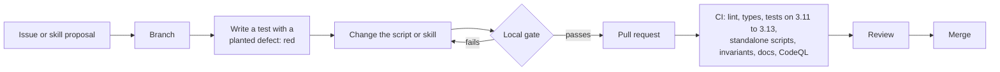

# Contributing

Contributions of skills, checks and fixes are welcome. Please keep everything **generic**: no specific designs, measurements, personal paths or CAD/print files. `tools/validate_repo.py` enforces this in CI.

## Setup

```bash
uv sync                    # Python 3.11+, all dev and CAD dependencies from uv.lock
uvx pre-commit install     # optional: run the fast checks on every commit
```

Or open the repository in the devcontainer (**Reopen in Container**), which runs `uv sync --locked` for you.

## Development loop



Before every pull request, run the local gate:

```bash
uv run ruff format --check . && uv run ruff check . && uv run mypy && uv run pytest && uv run tools/validate_repo.py
```

To run a single test:

```bash
uv run pytest tests/test_check_mesh.py::test_good_part_passes
```

## Repository layout

| Path | Purpose |
|---|---|
| `.github/` | **The plugin root.** It holds `plugin.json`, `mcp.json` and `skills/`. Copilot also reads `.github/skills/` directly when the repository is the open workspace, so there is only one copy of every skill. |
| `.github/plugin/marketplace.json` | The marketplace catalog that `copilot plugin marketplace add` reads |
| `.github/copilot-instructions.md` | Always-on workspace instructions; keep them short |
| `tests/` | pytest suite. It imports the skill scripts by path. |
| `tools/validate_repo.py` | Checks the rules that span several files (listed under "Repository invariants" below) |
| `.devcontainer/` | Reproducible environment: Python 3.12, uv, GL libraries for offscreen rendering |

## Writing a skill

- **Name it for the outcome**, in lowercase with hyphens. The name must match the folder name.
- **Description:**
  - Say what the skill does and when to use it, ending with "Use when ...". The validator requires this for agent-invoked skills.
  - Keep it under about 450 characters. Descriptions of all agent-invoked skills share an always-loaded budget, which the validator enforces.
  - Workflows that only the user should start get `disable-model-invocation: true` and cost no context.
- **Keep `SKILL.md` short.**
  - Start with what every use of the skill needs: a "which technique for which task" table, then the steps.
  - Move branch-specific detail into `references/*.md`, linked directly from `SKILL.md` (one level deep).
  - Leave out generic advice the model already follows.
- **Make every step checkable**, with a clear "done when ..." condition.
- **Back every number with a source.** Mark starting values as such.
- **Skills never import each other.** A skill may mention another skill by name, but must still work when installed alone.
- Add the skill to the skill table in the README and to `CHANGELOG.md`.

## Writing a script

Scripts live in `.github/skills/<skill>/scripts/` and follow one contract:

- A PEP 723 header lists every module-level import as a dependency, so `uv run script.py` works with no setup. Add new dependencies to the `cad` group in `pyproject.toml` as well.
- Typed, pure functions do the work. A thin `main(argv: list[str] | None = None) -> int` parses arguments, and the script ends with `sys.exit(main())`.
- Exit codes are the same in every script:

  | Code | Meaning |
  |---|---|
  | `0` | OK |
  | `1` | A check failed |
  | `2` | Usage error (bad arguments or unreadable input) |
  | `3` | Nothing was checked |

  Document them in the module docstring.
- Output is one summary line per result, plus `--json` where a machine reads it.
- Every check gets a test showing it **fails on a planted defect** and passes on a good part. Build test parts with build123d; never commit binary fixtures.
- Heavy optional dependencies (build123d for STEP input) are imported lazily, with an error message that says which `uv run --with ...` command to use instead.

## Repository invariants

`uv run tools/validate_repo.py` checks:

- **Skills:** frontmatter and size.
- **Scripts:** PEP 723 headers cover all imports; the CLI contract is followed.
- **Plugin:** the `plugin.json` and `mcp.json` schemas, and the marketplace entry.
- **Versions:** the version is identical in `pyproject.toml`, `plugin.json` and `marketplace.json`, and `CHANGELOG.md` has a section for it.
- **MCP config:** the plugin and the workspace register the same MCP servers.
- **README:** every skill is listed.
- **Tracked files:** no CAD or print files and no personal paths are tracked.

## Releasing

1. Move the `[Unreleased]` notes in `CHANGELOG.md` to a new `## [X.Y.Z]` section.
2. Set `X.Y.Z` in `pyproject.toml`, `.github/plugin.json` and `.github/plugin/marketplace.json`.
3. Run the local gate, then merge.
4. Tag: `git tag vX.Y.Z && git push origin vX.Y.Z`. The release workflow runs CI again, checks the tag against the version, and publishes the plugin zip with the changelog section as release notes.

Versioning follows SemVer:

- **Major:** a skill is renamed or removed, or a script CLI changes incompatibly.
- **Minor:** new skills or new options.
- **Patch:** fixes.
