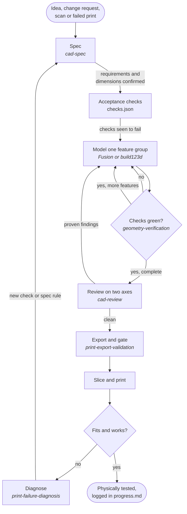
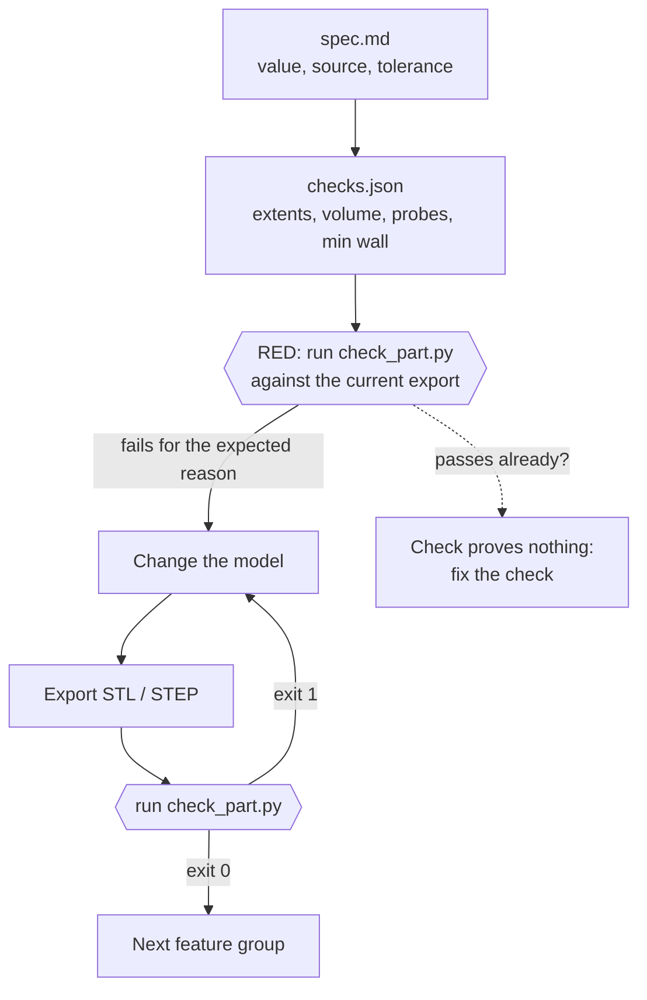
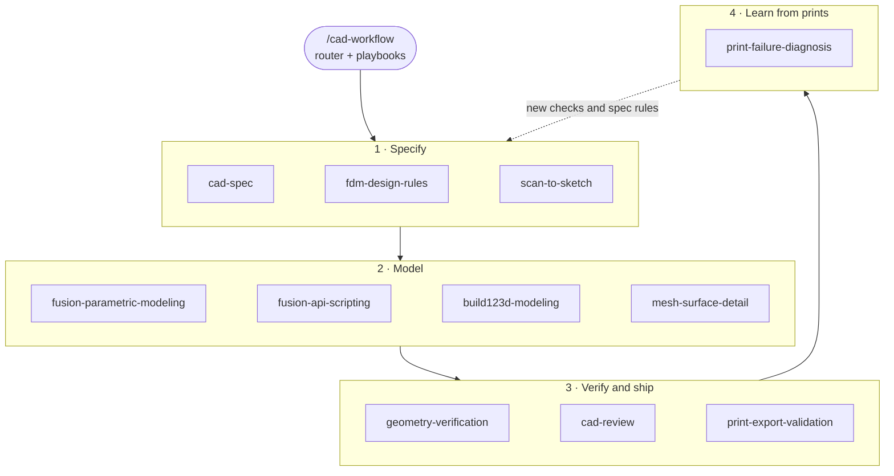
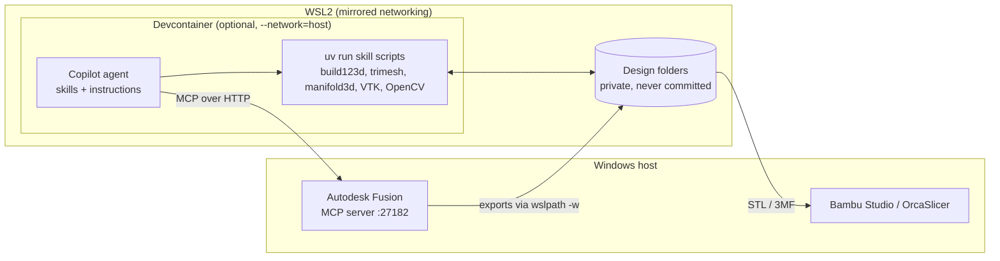
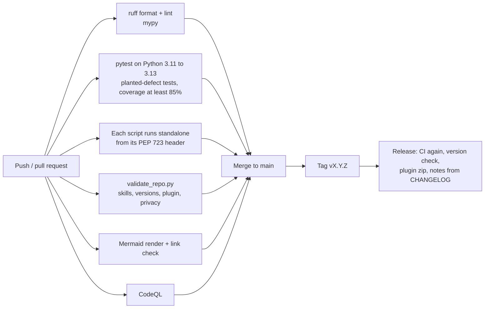

# CAD & 3D-printing skills for AI agents

[](https://github.com/FabianSchurig/cad-and-3d-printing-skills/actions/workflows/ci.yml)
[](LICENSE)

Agent skills, instructions and tested tooling for designing parts for **FDM 3D printing** with AI agents. They target GitHub Copilot in VS Code and the Copilot CLI, and follow the open [Agent Skills](https://agentskills.io) standard.

The skills apply a software-engineering way of working to CAD:

- write the spec first;
- write acceptance checks before modelling;
- work in small verified steps;
- review with evidence;
- release only validated files.

Two CAD back ends are supported:

- **Autodesk Fusion**, through its built-in MCP server;
- **build123d** code-CAD, which runs headless in a container or CI. You don't need Fusion to use this project or contribute to it.

## How it works

### Phase-gated workflow

`/cad-workflow` restates the goal, picks a playbook and walks through these gates. Each phase ends in a checkable state.



### Verification-first loop

This is the CAD equivalent of test-driven development. Expected values come from the spec and caliper measurements, never from the model itself.



### Skill map



### Environment



## Skills

| Skill | Invoked by | Purpose |
|---|---|---|
| `cad-workflow` | you (`/cad-workflow`) | Router: restates the goal, picks a playbook (new part, change, remodel from scan, size variants, print failure, pause/resume) and enforces the phase gates |
| `cad-spec` | agent | Writes `spec.md`, with value, source and tolerance for each dimension, plus the `checks.json` acceptance checks |
| `geometry-verification` | agent | Red/green loop with [`check_part.py`](.github/skills/geometry-verification/scripts/check_part.py), fits, slide paths and seals in several poses with [`check_assembly.py`](.github/skills/geometry-verification/scripts/check_assembly.py), and headless previews with [`render_preview.py`](.github/skills/geometry-verification/scripts/render_preview.py) |
| `cad-review` | agent | Two independent reviews (printability and model hygiene vs. spec conformance); every finding needs evidence |
| `fusion-parametric-modeling` | agent | Feature-order plan, user parameters, named timeline groups, variants generated from parameters |
| `fusion-api-scripting` | agent | Fusion API scripts through MCP: cm vs. mm, WSL paths, staged builds under the timeout, guard rails, and [snippets](.github/skills/fusion-api-scripting/references/snippets.md) for design inventory, user selection, fully constrained sketches and export |
| `build123d-modeling` | agent | Headless code-CAD: model-script contract, cheat sheet, export tolerances |
| `fdm-design-rules` | agent | Printable geometry, orientation and part splitting, materials |
| `scan-to-sketch` | agent | Calibrated outlines from scans with [`scan_to_outline.py`](.github/skills/scan-to-sketch/scripts/scan_to_outline.py): DXF, SVG, and a manifest with scale and uncertainty |
| `mesh-surface-detail` | agent | Reliefs and artwork on cylinders and cones with [`vector_relief.py`](.github/skills/mesh-surface-detail/scripts/vector_relief.py); when to use textures instead |
| `print-export-validation` | agent | Export gate with [`check_mesh.py`](.github/skills/print-export-validation/scripts/check_mesh.py), bed placement with [`place_on_bed.py`](.github/skills/print-export-validation/scripts/place_on_bed.py), mesh swaps in existing slicer projects with [`update_3mf_project.py`](.github/skills/print-export-validation/scripts/update_3mf_project.py), and [CLI slicing](.github/skills/print-export-validation/references/slicer-cli.md) |
| `print-failure-diagnosis` | agent | Tight test loop, falsifiable hypotheses, one change at a time, the lesson recorded as a check |

An agent-invoked skill costs only its one-paragraph description until it's needed; the full instructions load on demand.

Every script is a standalone CLI (`uv run <script> --help`) with the same exit codes:

| Code | Meaning |
|---|---|
| `0` | OK |
| `1` | A check failed |
| `2` | Usage error (bad arguments or unreadable input) |
| `3` | Nothing was checked |

## Install

**As a plugin.** Use the Copilot CLI, or `/plugin` in a VS Code Copilot session:

```bash
copilot plugin marketplace add FabianSchurig/cad-and-3d-printing-skills
copilot plugin install cad-and-3d-printing-skills@cad-and-3d-printing
```

This installs all skills and registers the Fusion MCP server. In VS Code you can also add `FabianSchurig/cad-and-3d-printing-skills` to the `chat.plugins.marketplaces` setting and install the plugin from **Chat: Open Customizations**.

**As your CAD workspace.** Clone the repository and open it in VS Code, optionally with **Reopen in Container**. Keep each design in its own top-level folder. The allow-list [`.gitignore`](.gitignore) tracks only the shareable setup, so your models, scans and print files are never committed.

**Copy selected skills.** Copy folders from [`.github/skills/`](.github/skills) into your repository's `.github/skills/`, or into `~/.copilot/skills/` to use them everywhere.

### Requirements

- [uv](https://docs.astral.sh/uv/) to run the scripts (each script declares its own dependencies), or use the [devcontainer](.devcontainer/devcontainer.json).
- For Fusion: enable its MCP server in Fusion's preferences (see Autodesk's guide, [Connecting to the Autodesk Fusion MCP Server](https://help.autodesk.com/view/fusion360/ENU/?guid=ADSKMCP_FusionDesktopMcp_connecting_to_the_fusion_mcp_server_html)).
- On WSL2, set `networkingMode=mirrored` in `%UserProfile%\.wslconfig` so that `127.0.0.1:27182` reaches Fusion on Windows.

## Design principles

- **Spec before geometry.** Every dimension has a source (measured, datasheet, derived or assumed) and a tolerance. Assumptions are never presented as measurements.
- **Checks before modelling, and seen to fail first.** A part is done when checks on the exported file pass, not when the script runs. Never shrink a feature or loosen a check just to pass.
- **Small verified steps.** Model one feature group at a time. Parameters drive every key dimension. Variants are regenerated from parameters, never scaled.
- **Evidence over opinion.** Reviews and diagnoses report measurements. Pictures show arrangement; numbers come from checks.
- **Deterministic work in scripts, judgement in the agent.** Scripts print one summary line plus machine-readable JSON, which keeps the agent's context small.
- **Honest status.** "Slice checked" is not "physically tested". Safety-relevant accessories carry no implied load rating.

## Quality

Every change runs through the same gate, locally and in CI:



See [CONTRIBUTING.md](CONTRIBUTING.md) for the development setup and the rules for writing skills.

## References

The projects and documents this setup builds on, and what it takes from each:

| Reference | What we use from it |
|---|---|
| [earthtojake/text-to-cad](https://github.com/earthtojake/text-to-cad) | build123d code-CAD; "start with the task" tables; a check for every kind of change; checks trusted only once seen to fail; OK / FAILED / NOT CHECKED exit codes; no shrinking a design to pass |
| [Open-Cascade-SAS/OCCT](https://github.com/Open-Cascade-SAS/OCCT) | The open-source B-Rep kernel behind build123d: STEP exchange, validity checks, meshing tolerances |
| [CNCKitchen/ScanRuler](https://github.com/CNCKitchen/ScanRuler) | Explicit scale states (uncalibrated / nominal / calibrated), separate X and Y calibration for flatbed scans, measured / partial / inferred labels, DXF hand-off. Ideas only; its AGPL code is not copied. |
| [CNCKitchen/stlTexturizer](https://github.com/CNCKitchen/stlTexturizer) (BumpMesh) | When to use displacement textures vs. vector reliefs; keeping the bed face flat and avoiding new overhangs. Ideas only; its AGPL code is not copied. |
| [cursor/plugins – pstack](https://github.com/cursor/plugins/tree/main/harness/pstack) | A router skill whose playbook steps are copied into the todo list; phase gates; proving work on the real file; fresh subagents given file paths; pause/resume notes |
| [mattpocock/skills](https://github.com/mattpocock/skills) | Skill-writing rules (descriptions as triggers, user- vs. model-invoked skills, loading detail only when needed); spec and TDD discipline; two-axis review; the diagnosis loop |
| [Hydra Research – Design Rules for FFF 3D Printing](https://www.hydraresearch3d.com/design-rules) | The values in `fdm-design-rules` |
| [build123d](https://github.com/gumyr/build123d) | The code-CAD library used by `build123d-modeling` and by the tests |
| [Agent Skills specification](https://agentskills.io/specification) | The `SKILL.md` format |
| [Agent Plugins specification](https://github.com/agentplugins/agent-plugins-spec) | `plugin.json` and `mcp.json` packaging |
| [VS Code: Agent Skills](https://code.visualstudio.com/docs/agent-customization/agent-skills) | Skill frontmatter and where skills are loaded from |
| [Copilot plugin and marketplace reference](https://docs.github.com/en/copilot/reference/plugin-and-marketplace-reference) | Plugin and marketplace layout |
| [Autodesk Fusion MCP server](https://help.autodesk.com/view/fusion360/ENU/?guid=ADSKMCP_FusionDesktopMcp_connecting_to_the_fusion_mcp_server_html) | The Fusion back end |

## License

[MIT](LICENSE)
